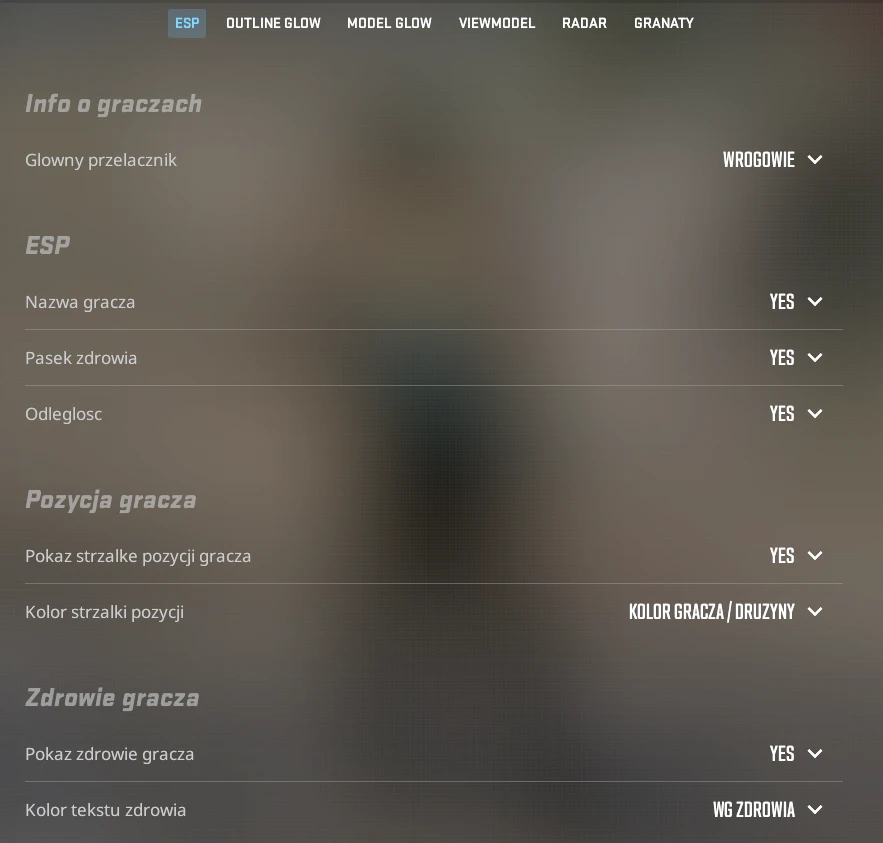
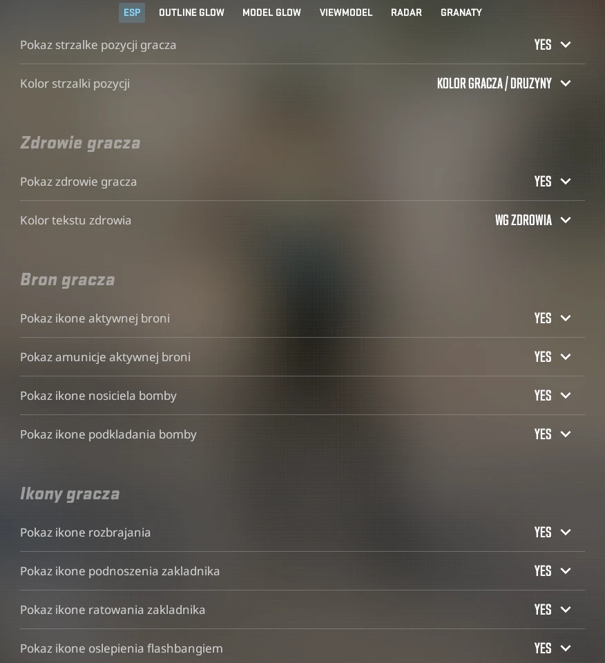
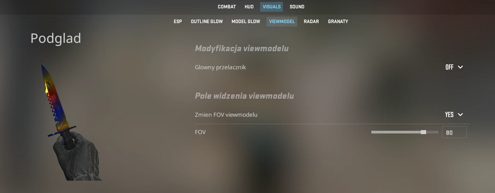
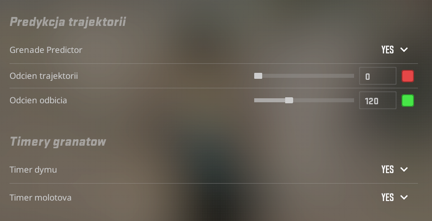
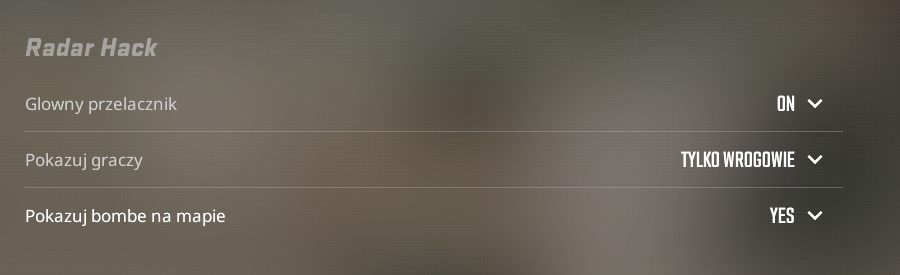
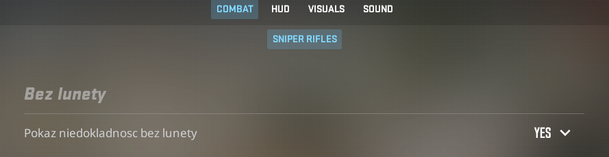
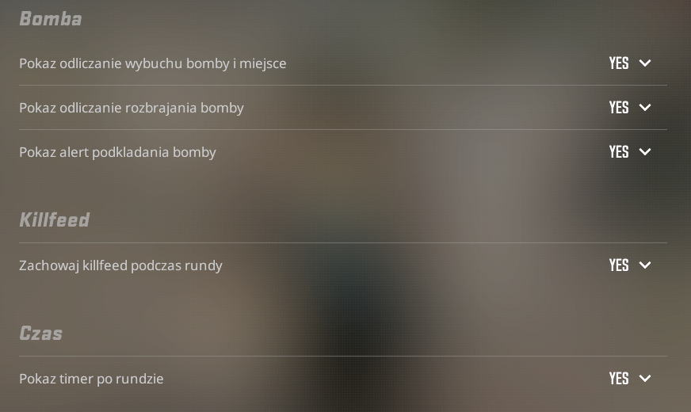
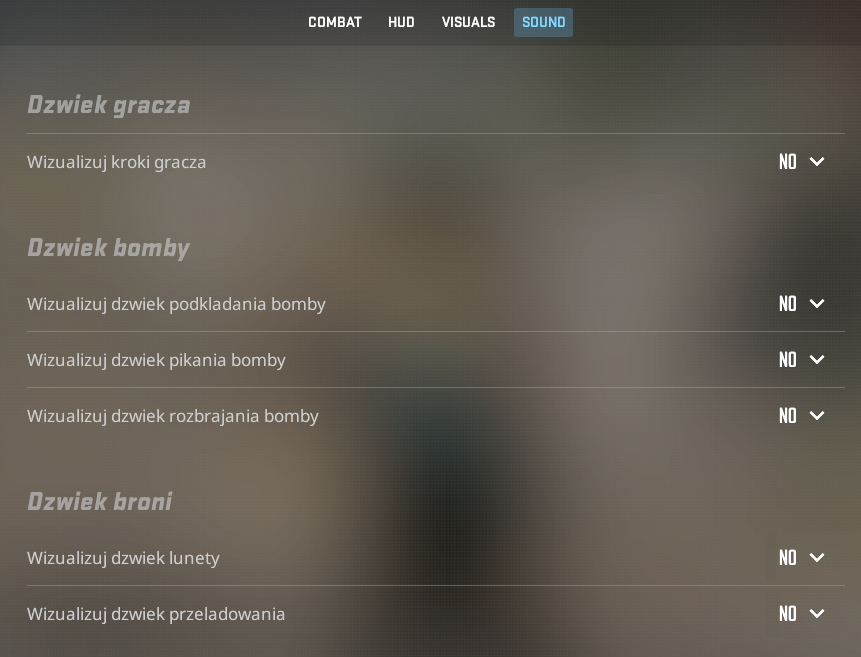

# Osiris Better

Enhanced fork of [Osiris](https://github.com/danielkrupinski/Osiris) — a free and open-source game hack for Counter-Strike 2 built with modern C++20.

> **Disclaimer:** This project is for educational purposes only. Use at your own risk.

## Features

### Visuals
- **Player ESP** — in-world player info panels with:
  - Health bar
  - Player name
  - Player distance
  - Active weapon ammo
  - Player weapon icon
  - Player position arrow
  - Player health text
  - Player bomb icon
- **Model Glow** — player, weapon, grenade, bomb (ticking & dropped), defuse kit glow with customizable color modes
- **Outline Glow** — player, weapon, grenade, bomb, hostage, defuse kit outline with color mode options
- **Grenade Timer** — visual indicator for active smoke and molotov/incendiary grenades
- **Radar Hack** — reveal all players on the radar

### HUD
- **Bomb Timer** — on-screen bomb countdown with site indicator
- **Defusing Alert** — defuse countdown overlay
- **Bomb Plant Alert** — notification when bomb is being planted
- **Post Round Timer** — timer after round ends
- **Killfeed Preserver** — keep killfeed entries visible longer

### Sound
- **Footstep Visualizer** — see enemy footstep positions
- **Bomb Beep Visualizer** — visualize bomb beeping
- **Bomb Plant/Defuse Visualizer** — see plant and defuse sounds
- **Weapon Reload Visualizer** — see weapon reload sounds
- **Weapon Scope Visualizer** — see weapon scope sounds

### Combat
- **No-Scope Inaccuracy Visualization** — show inaccuracy circle when unscoped with sniper rifles

## Showcase

| | |
|---|---|
|  |  |
|  |  |
|  |  |
|  |  |

## Requirements

- **OS:** Windows 11 / Linux
- **Compiler:** MSVC (Windows) or GCC/Clang (Linux) with C++20 support
- **Build system:** CMake 3.24+
- **Game:** Counter-Strike 2

## Building

### Windows

1. Clone the repo:
```powershell
git clone https://github.com/Kowersky/Osiris-Better.git
cd Osiris-Better
```

2. Generate the build files:
```powershell
cmake -B build -G "Visual Studio 17 2022" -A x64
```

3. Build:
```powershell
cmake --build build --config Release
```

The compiled DLL will be in `build/Source/Release/`.

**Or** open `Osiris.sln` directly in Visual Studio 2022 and build from there.

### Linux

1. Clone and build:
```bash
git clone https://github.com/Kowersky/Osiris-Better.git
cd Osiris-Better
cmake -B build -D CMAKE_BUILD_TYPE=Release
cmake --build build
```

The compiled shared library will be in `build/Source/`.

## Injection

### Windows
Use any DLL injector to load the compiled DLL into `cs2.exe`. The in-game GUI opens automatically via Panorama UI overlay.

### Linux
Load the shared library into the game process using a compatible injector (e.g., via `LD_PRELOAD` or a manual `dlopen` approach).

## Configuration

Settings are managed through the in-game Panorama UI. Changes are saved automatically between sessions. The config covers all feature toggles, colors, and visual parameters.

## Project Structure

```
Source/
├── CS2/            # Game class definitions and constants
├── Config/         # Configuration system
├── Features/       # Feature implementations
│   ├── Combat/     # Combat-related features
│   ├── Common/     # Shared utilities (in-world panels)
│   ├── Hud/        # HUD overlays (bomb timer, alerts)
│   ├── Sound/      # Sound visualization features
│   └── Visuals/    # ESP, glow, grenade timer, radar
├── GameClient/     # Game entity abstractions
├── Hooks/          # Game hook implementations
├── Platform/       # OS-specific code
└── UI/             # Panorama UI (HTML/JS/C++ bridge)
Tests/              # Unit and functional tests
```

## Credits

- [danielkrupinski/Osiris](https://github.com/danielkrupinski/Osiris) — original project
- [Kowersky](https://github.com/Kowersky) — this fork's additions and improvements

## License

This project is provided as-is for educational purposes.
